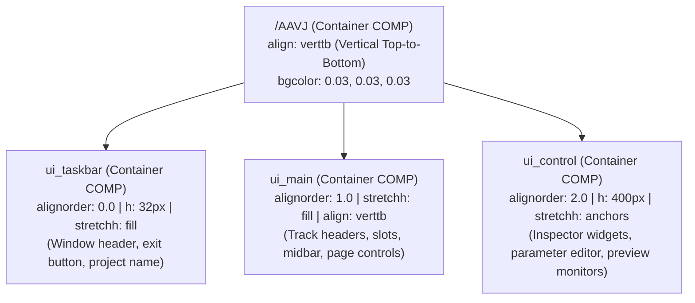

# TouchDesigner Modern UI Design System — AAVJ Standard

This skill encapsulates the UI/UX architecture, visual tokens, layout patterns, and performance contracts extracted from **AAVJ Beta** (`AAVJ_BETA_v1.26b`). Use this skill to design, restyle, or build sleek, high-density, pro audio-visual DAW interfaces in TouchDesigner 2025+.

---

## 1. Visual Identity & Aesthetic Principles

AAVJ's aesthetic is characterized by a **high-density, low-fatigue, precision pro-software visual language** (similar to Ableton Live, Bitwig Studio, Resolume Arena, and modern Disguise software):

- **Deep Slate Canvas:** Backgrounds avoid pure pitch black (`#000000`) and instead use micro-tuned dark slates (`0.03, 0.03, 0.03` / `#080808` to `0.05, 0.05, 0.05` / `#0d0d0d`).
- **Subtle 1px Geometric Borders:** Sharp, fine outline borders (`0.15, 0.15, 0.15, 0.6`) separate panels without creating heavy cognitive weight.
- **Micro-Contrast Accents:** Interactive active states use an elegant muted cyan/teal (`0.3276, 0.4719, 0.5200` / `#537885`) and subtle rollovers (`0.3086, 0.3185, 0.3185` at 35% opacity), reserving aggressive bright colors only for warnings (`warning_red`).
- **Typography of Choice:** **`Bahnschrift Condensed`** (native to Windows 10/11) delivers ultra-clean horizontal compactness, allowing dense parameter naming and labels without text clipping.

---

## 2. Centralized Color Token Engine (`/ui/colors`)

Never hardcode arbitrary RGB colors across individual panels. AAVJ maintains a centralized design token repository at `/ui/colors`.

### Semantic Token Palette

```python
AAVJ_PALETTE = {
    # --- Canvas & Panels ---
    'panel_bg':         (0.030, 0.030, 0.030, 1.0),   # Deepest container canvas (#080808)
    'panel_base':       (0.050, 0.050, 0.050, 0.95),  # Standard panel card background
    'panel_roll':       (0.080, 0.080, 0.080, 1.0),   # Panel hover / rollover state
    'panel_active':     (0.120, 0.120, 0.120, 1.0),   # Panel active / selected state

    # --- Typography ---
    'text_static':      (0.650, 0.650, 0.650, 1.0),   # Default readable label text (#a6a6a6)
    'text_roll':        (1.000, 1.000, 1.000, 1.0),   # Hover highlighted text (#ffffff)
    'text_active':      (0.900, 0.900, 0.900, 1.0),   # Active control label text
    'text_edit':        (0.200, 0.700, 0.900, 1.0),   # Inline field editing text

    # --- Borders & Outlines ---
    'outline_static':   (0.150, 0.150, 0.150, 0.5),   # Default 1px subtle separation border
    'outline_roll':     (0.350, 0.350, 0.350, 0.8),   # Rollover border highlight

    # --- Buttons & Controls ---
    'button_off':       (0.080, 0.080, 0.080, 0.8),   # Inactive button face
    'button_on':        (0.328, 0.472, 0.520, 1.0),   # Active / Toggled button face (Cyan/Teal)
    'button_onroll':    (0.400, 0.550, 0.600, 1.0),   # Active button hover
    'button_offroll':   (0.140, 0.140, 0.140, 0.9),   # Inactive button hover

    # --- Sliders & Meters ---
    'slider_base':      (0.021, 0.021, 0.021, 1.0),   # Slider track background
    'slider_fill':      (0.328, 0.472, 0.520, 0.85),  # Slider filled level
    'warning_red':      (0.800, 0.150, 0.150, 1.0),   # Alert / Mute / Clip warning
}
```

### Implementing the Token Store in TouchDesigner

Create a `baseCOMP` `/ui/colors` containing:
1. `constantTOP` nodes for each token (e.g. `panel_base`, `button_on`, etc.).
2. Merge them into a single `CHOP:out` table or reference dictionary so any UI component can bind dynamically:
   ```python
   # Expression binding on panel parameters:
   op('/ui/colors/out')['panel_base', 'r']
   ```

---

## 3. Responsive Layout Hierarchy (Flexbox Patterns in TouchDesigner)

AAVJ structures its main application window (`/AAVJ`) using procedural Container COMP alignments:



### Layout Alignment Rules
- **Vertical Stacks (`align = verttb`):** Order children strictly via `alignorder` (0.0, 1.0, 2.0). Never rely on spatial node coordinates.
- **Horizontal Strips (`align = horizlr`):** Used inside layer rows (`layer0`):
  - Left Sidebar / Header (`layerctrl`): Fixed width `w = 400`, `alignorder = 0.0`.
  - Clip Slots Strip (`slots`): `stretchw = fill`, `alignorder = 1.0`.
- **Responsive Stretches (`stretchh`, `stretchw`):**
  - Set `stretchh = fill` for panels that must adapt dynamically to window resizing.
  - Set `stretchh = fixed` (or `stretchw = fixed`) for standard toolbars (`h = 32px` or `40px`) and layer strips (`h = 96px`).

---

## 4. Hardware-Accelerated GLSL UI Shaders (`glslmultiTOP`)

Rather than compositing buttons with heavy TOP chains (Over, Level, Crop, Text), AAVJ uses a **single lightweight GLSL pixel shader** inside each button/slot (`ctrl/glslmulti1`):

### The AAVJ Interactive Button Shader (`glslmulti_pixel`)

```glsl
// AAVJ Interactive Slot / Button Shader
uniform int uState;          // 1 when actively playing / toggled, 0 otherwise
uniform int uHover;          // 1 on mouse rollover, 0 otherwise
uniform int uFocus;          // 1 when selected/focused, 0 otherwise
uniform int uLinkMode;       // 1 if in linking/routing mode
uniform int uLinked;         // 1 if currently linked
uniform vec4 uDefColor;      // Inactive background color
uniform vec4 uActiveColor;   // Active / Play color
uniform vec4 uLinkColor;     // Routing accent color

out vec4 fragColor;

void main()
{
    vec4 DefColor = uDefColor;
    vec4 ActiveColor = uActiveColor;
    vec4 LinkColor = uLinkColor;
    
    // Sample thumbnail (Input 0) at 80% brightness
    vec4 Thumb = texture(sTD2DInputs[0], vUV.st) * 0.8;
    
    vec4 StateColor = DefColor;
    StateColor += float(uState) * (ActiveColor * 0.3) + Thumb; 
    LinkColor = mix(LinkColor * 0.2, LinkColor * 0.8, float(uLinked)) + Thumb;
    
    vec4 AAoutput = mix(StateColor, LinkColor, float(uLinkMode));
    
    // Instant hover brightening without CPU panel cook
    AAoutput += AAoutput * (float(uHover) * 0.25);
    
    fragColor = TDOutputSwizzle(AAoutput);
}
```

### Why This Outperforms Traditional TD Buttons
1. **Zero Texture Reallocations:** The shader renders into a fixed thumbnail texture (`95x95` or `128x128`).
2. **Instant Rollover:** `uHover` updates a uniform float; no TOP re-cooking is triggered.
3. **GPU Compositing:** State color tint, thumbnail, and hover are resolved in a single render pass.

---

## 5. Control & Widget Architecture

### A. Modern Dropdown Menu Widget (`dropDownMenu`)
- **Widget Type:** TouchDesigner `widget` COMP (`dropDownMenu`).
- **Key Parameters:**
  - `Font`: `Bahnschrift Condensed`
  - `Labelfontsize`: `12pt`, `Labelfontfraction`: `0.689`
  - `Menubuttononfacecolor`: `(0.328, 0.472, 0.520, 1.0)` (Cyan accent)
  - `Menubuttonofffacecolor`: `(0.080, 0.080, 0.080, 0.8)`
  - `Menubgcolor`: `(0.021, 0.021, 0.021, 1.0)`
  - `Menurollcolor`: `(0.308, 0.318, 0.318, 1.0)` at `0.35` opacity
  - `h`: `30px` (standard control height)

### B. Vertical Level Slider (`level`)
- **Widget Type:** `sliderCOMP` (`w = 40`, `h = 100`).
- **Internal Components:**
  - `ctrl`: Contains GLSL level bar or slider shape.
  - `null_val`: Evaluates normalized output float (`0.0`–`1.0`).
  - Background: Transparent (`bgalpha = 0.0`), allowing layer card background to show through.

### C. Output Preview Monitor with Checkerboard
- **Widget Type:** `containerCOMP` with `topfill = best` (Fit Best aspect ratio).
- **Internal Chain:**
  1. `select_output`: Selects target `out1` or `out2` TOP.
  2. `checker (base)`: Procedural black-and-dark-gray checkerboard pattern (`16x16px`) indicating transparency.
  3. `comp1 (compTOP)`: Composites output over checkerboard (`operation = over`).
  4. `fit1 (fitTOP)`: Fits to container aspect ratio without stretching or distortion.
  5. `null_bg`: Wired directly to parent's `top` parameter.

### D. Real-Time Telemetry Bar (`ui_stats`)
- **FPS Monitor (`fpxstats`):** `performCHOP` sampling `cookrate` and `msec`, formatted into high-DPI monospace readout.
- **VRAM Monitor (`vramstats`):** `performCHOP` sampling `gpu_mem_used` and `gpu_mem_total`, computing percentage with warning color threshold (`> 85%` switches to `warning_red`).

---

## 6. Vulkan 60 FPS Performance Contracts for UI

1. **NEVER use `outputresolution = parpanel` inside interactively resizable widgets:**
   - Always allocate fixed resolution (e.g. `512x32`, `256x256`, or `1024x32`) with `outputresolution = custom`.
   - Set Container COMP `topfill = stretch` or `horizontal`.
   - Modifying panel width/height frame-by-frame destroys and reallocates Vulkan textures, causing massive frame drops.
2. **Never query `.width` or `.height` synchronously inside `whileOn` loops:**
   - Querying dimensions forces TouchDesigner to solve the entire CPU layout tree mid-frame.
   - Use normalized panel coordinates (`insideu`, `insidev`) and compute pixel positions procedurally.
3. **Debounce Panel Callbacks:**
   - In `panelexecuteDAT`, enable only required triggers (`offtoon = True`, `onoff = False`, `whileon = False`).
   - If `whileon` is necessary (e.g. scrubbing), always enforce a motion guard:
     ```python
     curr_u = self.ownerComp.panel.insideu.val
     if self._last_u is not None and abs(curr_u - self._last_u) < 1e-5:
         return
     self._last_u = curr_u
     ```
